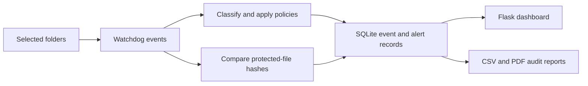

<div align="center">

# Secure File Transfer Monitoring System

**Local filesystem monitoring, policy alerts, SHA-256 integrity checks, and audit reports.**

[](https://www.python.org/)
[](https://flask.palletsprojects.com/)
[](https://python-watchdog.readthedocs.io/)

[Open the read-only demo](https://secure-file-transfer-monitor-demo.onrender.com/) · [Run locally](#run-locally) · [Architecture](docs/ARCHITECTURE.md)

</div>

SFTMS is a local-first academic security project. It watches folders selected by the user, records filesystem events, applies transparent movement policies, compares SHA-256 integrity baselines, and exports audit reports.

> **Monitoring happens on the computer running the app.** The public Render page is a read-only synthetic preview and cannot monitor files on your device.

## Public demo

The [Render demo](https://secure-file-transfer-monitor-demo.onrender.com/) is read-only and uses synthetic data. It is provided to preview the dashboard; it does not watch your folders. Do not enter private information into a public demo.

For real local monitoring, run SFTMS on the computer that has the folders you want to observe.

## Features

- Record file creation, modification, movement, and deletion in configured folders
- Classify events using sensitive-directory labels and file-extension rules
- Apply policies for allowed and restricted destinations
- Protect files with a SHA-256 baseline and report verified, changed, or deleted states
- Raise alerts for policy violations, integrity mismatches, and suspicious bulk activity
- Review events and alerts in a Flask dashboard; export persisted activity as CSV or PDF
- Keep monitoring data in a local SQLite database

## How it works



## Run locally

Requires Python 3.11 or later.

```powershell
git clone https://github.com/DangerousEra/secure-file-transfer-monitoring-system.git
cd secure-file-transfer-monitoring-system
python -m venv .venv
.\.venv\Scripts\Activate.ps1
python -m pip install -r requirements.txt
Copy-Item .env.example .env
python app.py
```

Open [http://127.0.0.1:5000](http://127.0.0.1:5000). In **Settings & Monitoring**, add existing folders you are permitted to monitor, then select **Start**. Restart monitoring after changing the folder list.

On macOS or Linux, activate the environment with `source .venv/bin/activate` before installing dependencies.

## Safe demonstration

The demo creates synthetic files only under `data/demo_environment`.

1. Start the dashboard with `python app.py`.
2. In **Settings & Monitoring**, select **Create demo environment**, then **Start**.
3. Open a second terminal in the project folder and run:

   ```powershell
   python demo.py
   ```

Refresh the dashboard to review the resulting events, alerts, and integrity checks. The generated activity demonstrates normal creation, restricted movement, an integrity mismatch, protected-file deletion, bulk activity, and an allowed transfer.

## Reports

Open **Reports** in the dashboard and choose CSV or PDF. Exports are generated from records stored in SQLite and do not invent events. CSV values that could be interpreted as spreadsheet formulas are escaped.

## Safety and limitations

- The app records file metadata and hashes; it does not upload, edit, delete, or encrypt monitored files.
- Watchdog reports observable filesystem changes. It may not identify the originating process or distinguish every copy, upload, download, USB, or cloud-sync operation.
- USB, network-share, and cloud-sync behavior is observable only when the relevant folders are explicitly configured and accessible.
- Policy alerts indicate activity to investigate; they do not prove malicious intent or prevent data loss.
- Integrity checks compare a file with a saved SHA-256 baseline. They do not identify who changed it or recover deleted content.
- SQLite and the local dashboard are intended for this academic demonstration, not multi-host enterprise monitoring.

See [Detection boundaries](docs/LIMITATIONS.md) for the full limitations.

## Tests

```powershell
python -m pytest -q
```

## Project layout

| Path | Purpose |
| --- | --- |
| `app.py`, `api/` | Flask application and API routes |
| `core/` | Monitoring, classification, policies, integrity, alerts, and reports |
| `database/` | SQLite schema and data access |
| `templates/`, `static/` | Dashboard UI and browser assets |
| `tests/` | Automated tests |
| `docs/` | Architecture, user guide, testing notes, and limitations |

More detail: [User guide](docs/USER_GUIDE.md) · [Architecture](docs/ARCHITECTURE.md) · [Limitations](docs/LIMITATIONS.md)
